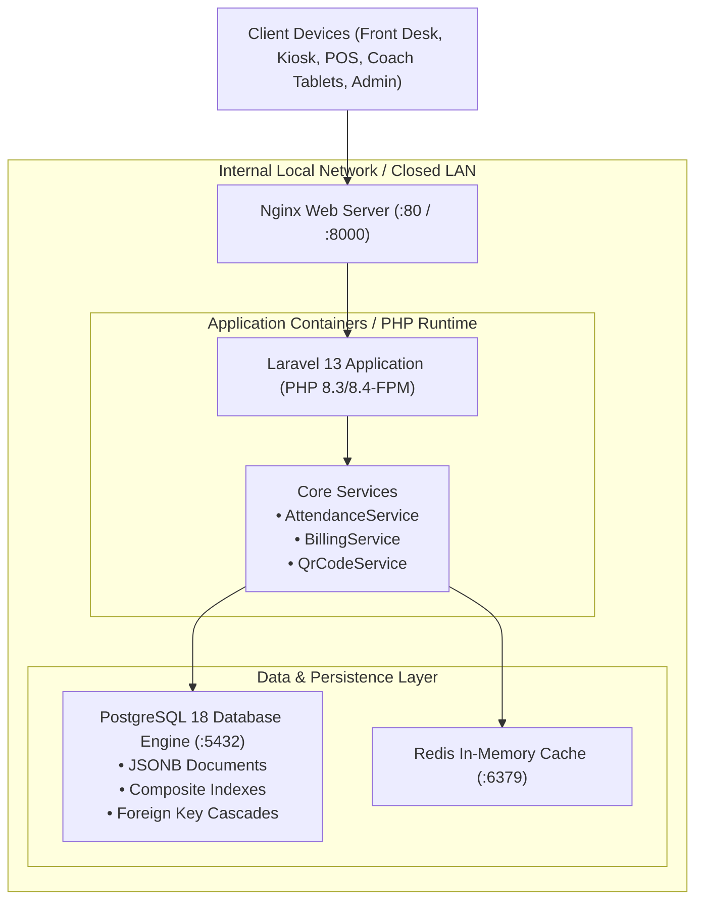
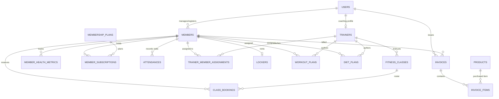

# 🏋️‍♂️ Gym Management System

> **Production-Ready, Sophisticated Commercial Fitness Management Web Application**  
> Built with **Laravel 13**, **PostgreSQL 18**, **Bootstrap 5.3**, and **Font Awesome 6**.  
> **100% Offline & Closed Internal Network (LAN/Intranet) Architecture**: All stylesheets, JavaScript libraries, icons, webfonts, and analytical charting components are stored locally in the project repository (`public/vendor/`). Zero reliance on public CDNs, internet access, or external cloud APIs.

---

## 📑 Table of Contents

1. [Executive Overview](#1-executive-overview)
2. [Technical Stack & Architecture](#2-technical-stack--architecture)
3. [Offline & Air-Gapped Network Design](#3-offline--air-gapped-network-design)
4. [Comprehensive Module Breakdown](#4-comprehensive-module-breakdown)
   - [4.1 Executive Dashboard & Operational Analytics](#41-executive-dashboard--operational-analytics)
   - [4.2 Turnstile & Access Control Kiosk](#42-turnstile--access-control-kiosk)
   - [4.3 360-Degree Member Management & Digital Pass](#43-360-degree-member-management--digital-pass)
   - [4.4 Membership Plans & Subscription Billing](#44-membership-plans--subscription-billing)
   - [4.5 Group Classes & Timetable Roster](#45-group-classes--timetable-roster)
   - [4.6 Personal Training & Coach Allocation](#46-personal-training--coach-allocation)
   - [4.7 Workout Routine & Nutrition Diet Builders](#47-workout-routine--nutrition-diet-builders)
   - [4.8 Point of Sale (POS) & Pro-Shop Inventory](#48-point-of-sale-pos--pro-shop-inventory)
   - [4.9 Invoices & Financial Accounting](#49-invoices--financial-accounting)
   - [4.10 Locker Room Matrix & Key Allocations](#410-locker-room-matrix--key-allocations)
   - [4.11 Gym Equipment & Maintenance Log](#411-gym-equipment--maintenance-log)
   - [4.12 Bulk Data Import & Migration Center](#412-bulk-data-import--migration-center)
   - [4.13 Business Reports & Data Exports](#413-business-reports--data-exports)
   - [4.14 System Settings & PostgreSQL 18 Diagnostics](#414-system-settings--postgresql-18-diagnostics)
5. [Database Schema & PostgreSQL 18 Optimizations](#5-database-schema--postgresql-18-optimizations)
6. [Pre-Seeded Demo Accounts & Role Matrix](#6-pre-seeded-demo-accounts--role-matrix)
7. [Installation & Deployment Instructions](#7-installation--deployment-instructions)
   - [Method A: Production Docker Stack (Recommended)](#method-a-production-docker-stack-recommended)
   - [Method B: Local Bare-Metal Setup](#method-b-local-bare-metal-setup)
   - [Method C: Direct PostgreSQL 18 SQL Import](#method-c-direct-postgresql-18-sql-import)
8. [Automated Scheduled Tasks & Console Commands](#8-automated-scheduled-tasks--console-commands)
9. [Bulk Import Specifications & CSV Schemas](#9-bulk-import-specifications--csv-schemas)
10. [Troubleshooting & Frequently Asked Questions](#10-troubleshooting--frequently-asked-questions)
11. [License](#11-license)

---

## 1. Executive Overview

**Gym Management System** is an enterprise-grade web application engineered for modern commercial health clubs, CrossFit boxes, combat sports academies, and multi-branch fitness centers. 

It handles day-to-day gym workflows including:
- **Member Intake & Renewals**: Complete enrollment lifecycle with health metrics and automatic BMI calculation.
- **Access Control & Front Desk Scanning**: Instant RFID, QR, and barcode validation with occupancy tracking and grace period support.
- **Personal Training Management**: Session allotment packages, client logs, and progress indicators.
- **Group Exercise Classes**: Weekly scheduling with capacity meters and attendance taking.
- **Pro-Shop Point of Sale (POS)**: Supplement and gear retailing, barcode lookup, automated stock decrementing, and low-inventory warnings.
- **Facility Maintenance**: Locker room occupancy grid and machine safety inspection logs.
- **Data Ingestion**: Multi-entity CSV bulk import with downloadable sample templates and validation reporting.

---

## 2. Technical Stack & Architecture



| Component | Technology | Version / Spec | Architecture Purpose |
|---|---|---|---|
| **Backend Framework** | **Laravel** | **13.x** / PHP ^8.2 \| ^8.3 \| ^8.4 | Service-layer architecture, strict types, match expressions, Eloquent ORM |
| **Database Engine** | **PostgreSQL** | **18.x** | Advanced relational persistence, `JSONB` for unstructured workout splits and nutrition macros, cascade integrity |
| **Frontend UI** | **Bootstrap** | **5.3.3** | Responsive grid, accessible form controls, modals, offcanvas drawers |
| **Icon Systems** | **Font Awesome** & **Bootstrap Icons** | **6.7.2** & **1.11.3** | 100% self-hosted webfonts (`.woff2`, `.woff`, `.ttf`) bundled in `public/vendor/` |
| **Data Visualization** | **Chart.js** | **4.4.8** | Self-hosted UMD distribution for offline client-side analytical dashboards |
| **Pass Generator** | **Pure-PHP SVG Engine** | **Native PHP** | Vector QR codes & Code-128 barcodes rendered on-the-fly without third-party APIs |
| **Server / Proxy** | **Nginx** | **Alpine** | Static asset caching with HTTP FastCGI pass |
| **Cache & Sessions** | **Redis** | **Alpine** | High-throughput in-memory caching and session synchronization |

---

## 3. Offline & Air-Gapped Network Design

This application was engineered with a strict **Offline-First / Intranet-Guaranteed** philosophy:

1. **Zero External CDN Dependencies**:
   - Every CSS stylesheet, JavaScript bundle, webfont file, and icon asset resides in `public/vendor/`.
   - Blade layouts reference local assets using `{{ asset('vendor/...') }}`.
   - If the gym's public internet service is disconnected, front-desk turnstiles, scan kiosks, POS registers, and admin dashboards continue operating without degradation.

2. **Self-Contained Pure-PHP SVG Generation**:
   - Member digital passes and invoice barcodes do not query Google Charts or external QR APIs.
   - The [`QrCodeService`](file:///c:/xampp/htdocs/gym-management/app/Services/QrCodeService.php) generates mathematically correct, scalable SVG QR matrices and Code-128 barcodes in pure PHP with zero binary requirements.

3. **Local Asset Inventory**:
   ```
   public/vendor/
   ├── bootstrap/
   │   ├── css/bootstrap.min.css         (232 KB)
   │   └── js/bootstrap.bundle.min.js    (80 KB)
   ├── fontawesome/
   │   ├── css/all.min.css               (73 KB)
   │   └── webfonts/                     (fa-solid, fa-regular, fa-brands, woff2/ttf)
   ├── bootstrap-icons/
   │   ├── font/bootstrap-icons.min.css  (85 KB)
   │   └── font/fonts/                   (bootstrap-icons.woff & woff2)
   └── chartjs/
       └── chart.umd.js                  (206 KB)
   ```

---

## 4. Comprehensive Module Breakdown

### 4.1 Executive Dashboard & Operational Analytics
* **Real-Time KPI Metric Cards**:
  - **Active Members**: Current active subscriptions vs total historical member registrations.
  - **Inside Gym Now**: Real-time headcount of members currently in the facility.
  - **Monthly Revenue**: Month-to-date paid invoice volume formatted in the configured currency.
  - **Expiring Subscriptions**: Subscriptions reaching expiration within the next 7 days.
  - **Inventory Health**: Real-time counter of products at or below their low-stock threshold.
* **Interactive Chart.js Visualizations**:
  - **Monthly Revenue Trend**: 6-month historical revenue area line chart.
  - **Peak Gym Hours Heat Distribution**: Hourly bar chart showing attendance frequency between 6:00 AM and 10:00 PM.
  - **Membership Plan Breakdown**: Doughnut chart reflecting distribution across membership tiers.
* **Live Turnstile Stream**: Real-time table of recent check-ins with time elapsed and one-click check-out buttons.
* **Today's Classes Widget**: Instant glance at group exercise sessions scheduled for today.

### 4.2 Turnstile & Access Control Kiosk
* **High-Speed Input Field**: Autofocused input ready for USB/Bluetooth barcode guns, RFID magnetic swipers, or manual entry.
* **Smart Auto-Toggle Logic**:
  - If a member scans in and is currently outside $\rightarrow$ checks them in.
  - If a member scans in and is already inside $\rightarrow$ checks them out and logs workout duration in minutes.
- **Explicit Override Modes**: Toggle buttons for manual Check-In or Check-Out.
- **Eligibility Safeguards**:
  - Validates active subscription status.
  - Prevents entry for suspended or frozen memberships.
  - Handles the configurable grace period (e.g., permits entry for 3 days after expiration with an advisory warning).

### 4.3 360-Degree Member Management & Digital Pass
* **Member Directory**:
  - Search across First Name, Last Name, Member Code, Email, Phone, Barcode, and RFID tag.
  - Filter by status (`active`, `expired`, `frozen`, `suspended`, `inactive`) and membership plan.
* **Full Member Profile**:
  - Contact information, age, blood type, emergency contact, and medical restriction notes.
  - Interactive tabs: Subscriptions History, Health & Body Metrics, Attendance Records, Coaching & Routines, Billing Invoices.
* **Digital ID Pass & Wallet Badge**:
  - Printable pass with member photo avatar, vector QR code, Code-128 barcode, and expiration date.
* **Health & Body Composition Tracking**:
  - Logs Weight (kg), Height (cm), Automatic BMI calculation & category (`Normal weight`, `Overweight`, `Obese`), Body Fat %, Muscle Mass, Chest, Waist, Arms, and Thigh measurements.
* **Subscription Lifecycle Actions**:
  - **Renew Subscription**: One-click renewal modal creating an invoice and extending validity.
  - **Freeze / Pause Membership**: Allows freezing a membership for a set number of days (e.g., medical leave), extending the subscription end date automatically.

### 4.4 Membership Plans & Subscription Billing
* **Pre-Seeded Tier Configurations**:
  - **Silver Monthly** ($49/mo): General gym floor access.
  - **Gold Quarterly** ($129/3mo): Includes group fitness classes and 2 personal training sessions.
  - **Platinum VIP Annual** ($480/yr): Unlimited classes, 10 PT sessions, dedicated locker, zero admission fee.
  - **CrossFit & Boxing Special** ($89/mo): Functional turf and combat boxing access.
  - **Student Semester Pass** ($120/4mo): Discounted student rate.
* **Dynamic Plan Privileges**: Duration count/type, price, admission fee, class access toggle, PT session allowances, max freeze allowances, and JSONB feature lists.

### 4.5 Group Classes & Timetable Roster
* **Weekly Schedule Grid**: Filter classes by day of the week or view full schedule.
* **Capacity Safeguards**: Tracks available vs reserved spots in real time to prevent overbooking.
* **Class Roster Management**: Instructors can view registered attendees, mark attendance (`Attended`, `No Show`), or cancel bookings.

### 4.6 Personal Training & Coach Allocation
* **Coach Hub**: Trainer profiles, certifications (`NSCA-CSCS`, `NASM`), hourly rates, specialties (`Powerlifting`, `HIIT`, `Rehab`).
* **1-on-1 PT Coaching Packages**: Assign members to trainers with session allotments (e.g., 10 or 20 sessions).
* **Session Progress Tracking**: One-click logging of completed training sessions with visual progress bars.

### 4.7 Workout Routine & Nutrition Diet Builders
* **Workout Routine Builder**: Day-by-day routines (Push/Pull/Legs splits) with exercise names, sets, reps, rest intervals, and cues stored in PostgreSQL `JSONB`.
* **Macro & Diet Plan Builder**: Caloric targets, macronutrient goals (Protein, Carbs, Fats), and daily meal schedules (Meal 1, 2, 3, 4 with portions).
* **One-Click Member Assignment**: Duplicate any workout or diet template directly to an individual member's profile.

### 4.8 Point of Sale (POS) & Pro-Shop Inventory
* **Interactive Checkout Terminal**: Category filter tabs (Supplements, Beverages, Apparel, Accessories, Snacks) and product search.
* **Dynamic Cart Drawer**: Live quantity changes, subtotal, sales tax computation, custom discount application, customer selection (Registered Member or Walk-In), and payment tender.
* **Inventory Control**: Stock counts, cost vs selling prices, profit margin percentages, and automated low-stock warnings.

### 4.9 Invoices & Financial Accounting
* **Print-Ready A4 Invoices**: Clean, printable invoices complete with gym branding, tax registration, barcode, itemized table, and payment status badges.
* **Payment Recording**: Support for Cash, Credit Card POS, Debit, Direct Bank Transfer, and QRIS / Mobile QR.
* **CSV Export**: Instant export of member registers and financial transaction records.

### 4.10 Locker Room Matrix & Key Allocations
* **Visual Zone Grid**: Men's Locker Room, Women's Locker Room, and VIP Executive Suite.
* **Color-Coded Statuses**: Green (Available), Blue (Occupied with member name and expiration date), Yellow (Maintenance).
* **Rental Term Tracking**: Assign lockers to members for 1 to 12 months with automated fee billing.

### 4.11 Gym Equipment & Maintenance Log
* **Asset Registry**: Track treadmills, power racks, cable crossovers, rowing machines, and calibrated plates.
* **Safety & Maintenance Alerts**: Flags equipment past due for safety service inspections.
* **Service Logging**: Record maintenance dates, technician notes, parts replaced, and automatically schedule next inspection dates.

### 4.12 Bulk Data Import & Migration Center
* **Multi-Entity Bulk Ingestion**: Import Members, Pro-Shop Products, and Gym Equipment via CSV spreadsheets.
* **Downloadable Sample CSVs**: One-click download of pre-filled sample templates (`sample_members_import.csv`, `sample_products_import.csv`, `sample_equipment_import.csv`).
* **Smart Upsert & Error Handling**: Updates inventory for existing SKUs, auto-generates member codes, strips UTF-8 BOM, and displays row-by-row error logs.

### 4.13 Business Reports & Data Exports
* **Financial Performance**: Gross revenue, tax collected, membership subscriptions revenue, and retail POS breakdown.
* **Tender Distribution**: Revenue by payment method (Cash, Card, QRIS, Bank Transfer).
* **Direct CSV Exports**: One-click streaming download of complete Member Directories and Invoice Ledgers.

### 4.14 System Settings & PostgreSQL 18 Diagnostics
* **Branding & Parameters**: Legal gym name, tagline, facility address, phone, email, sales tax rate, currency symbol, and grace period days.
* **Diagnostics Panel**: Real-time inspection of PostgreSQL connection status, database server version, framework version, PHP runtime, and offline status.

---

## 5. Database Schema & PostgreSQL 18 Optimizations



### 📋 Database Tables Dictionary

| Table Name | Primary Purpose | Key Columns | PostgreSQL 18 Features |
|---|---|---|---|
| `users` | Staff, trainers & administrators | `id`, `name`, `email`, `role`, `status` | Role & status indexes |
| `members` | Gym member profiles | `id`, `member_code`, `first_name`, `last_name`, `email`, `phone`, `status` | Unique `member_code`, `JSONB` for `fitness_goals`, composite index `(status, created_at)` |
| `member_health_metrics` | Health, weight & BMI history | `id`, `member_id`, `recorded_date`, `weight_kg`, `height_cm`, `bmi` | `NUMERIC(5,2)`, composite index `(member_id, recorded_date)`, cascade delete |
| `membership_plans` | Packages & pricing tiers | `id`, `name`, `slug`, `price`, `duration_count`, `features` | Unique `slug`, `JSONB` for `features` array |
| `member_subscriptions` | Active & historical passes | `id`, `member_id`, `plan_id`, `start_date`, `end_date`, `status` | Composite index `(member_id, status)` & `(end_date, status)` |
| `attendances` | Turnstile gate access records | `id`, `member_id`, `check_in_time`, `check_out_time`, `check_in_method` | `TIMESTAMPTZ`, composite index `(check_in_time, check_out_time)` |
| `trainers` | Certified fitness coaches | `id`, `user_id`, `full_name`, `hourly_rate`, `specialties` | `JSONB` for `specialties` array, foreign key to `users` |
| `trainer_member_assignments` | 1-on-1 PT coaching packages | `id`, `trainer_id`, `member_id`, `total_sessions`, `completed_sessions` | Integer session counters, cascade deletes |
| `fitness_classes` | Group timetable schedule | `id`, `title`, `room`, `capacity`, `day_of_week`, `start_time` | Capacity bounds, day & active composite index |
| `class_bookings` | Class reservations & roster | `id`, `class_id`, `member_id`, `booking_date`, `status` | Unique composite constraint `(class_id, member_id, booking_date)` |
| `workout_plans` | Exercise splits & routines | `id`, `title`, `difficulty_level`, `routine_schedule`, `is_template` | `JSONB` structured exercise hierarchy |
| `diet_plans` | Nutrition targets & meals | `id`, `title`, `target_calories`, `protein_grams`, `meals` | `JSONB` meal timing structure |
| `products` | Pro-Shop retail inventory | `id`, `sku`, `name`, `category`, `selling_price`, `stock_quantity` | Unique `sku`, low-stock threshold queries |
| `invoices` | Transaction billing ledgers | `id`, `invoice_number`, `member_id`, `subtotal`, `tax_amount`, `total_amount` | Unique `invoice_number`, composite index `(payment_status, created_at)` |
| `invoice_items` | Itemized invoice rows | `id`, `invoice_id`, `item_description`, `unit_price`, `quantity`, `total_price` | Polymorphic morphs (`itemable`), cascade delete |
| `lockers` | Locker matrix records | `id`, `locker_number`, `zone`, `status`, `assigned_member_id` | Unique `locker_number`, composite index `(zone, status)` |
| `equipment` | Machines & service logs | `id`, `name`, `category`, `serial_number`, `next_service_due`, `status` | Maintenance tracking, composite index `(category, status)` |
| `gym_settings` | Dynamic club configuration | `id`, `key`, `value`, `group` | Unique `key`, `JSONB` value storage |

---

## 6. Pre-Seeded Demo Accounts & Role Matrix

The application seeds accounts across all operational roles. Default password for all accounts: **`password123`**:

| Role | Email Address | Password | Permissions & Access Scope |
|---|---|---|---|
| **Admin (General Manager)** | `admin@gym.local` | `password123` | Unrestricted full access to all modules, analytics, system settings, and bulk data import |
| **Operations Manager** | `manager@gym.local` | `password123` | Member directory, plans, classes, POS, lockers, equipment, reports, bulk import, and settings |
| **Front Desk (Reception)** | `reception@gym.local` | `password123` | Fast turnstile kiosk, member enrollment, attendance logs, POS checkout, invoice payments |
| **Head Coach (Personal Trainer)** | `alex.trainer@gym.local` | `password123` | Assigned client rosters, logging PT sessions, authoring workout splits, diet plans, class rosters |
| **Yoga & HIIT Instructor** | `maya.trainer@gym.local` | `password123` | Client assignments, class timetables, nutrition plans |

> **Quick-Login Feature**: The login page includes one-click autofill buttons for these test accounts.

---

## 7. Installation & Deployment Instructions

### Method A: Production Docker Stack (Recommended)

Run the full stack with **PostgreSQL 18**, **PHP 8.3/8.4-FPM**, **Nginx**, and **Redis** without upgrading your local PHP runtime:

1. **Open PowerShell or Terminal** in the project directory:
   ```powershell
   cd c:\xampp\htdocs\gym-management
   ```

2. **Spin up the Docker containers in detached mode**:
   ```powershell
   docker compose up -d
   ```

3. **Install Composer dependencies and run database migrations with seeders** (initial run only):
   ```powershell
   docker compose exec app composer install
   docker compose exec app php artisan migrate --seed
   ```

4. **Access the application**:
   Open your browser to:
   ```
   http://localhost:8000
   ```

---

### Method B: Local Bare-Metal Setup

For environments with **PHP 8.2+ / 8.3+** and a running PostgreSQL 18 instance:

1. **Verify your `.env` database configuration**:
   ```env
   DB_CONNECTION=pgsql
   DB_HOST=127.0.0.1
   DB_PORT=5432
   DB_DATABASE=gym_management
   DB_USERNAME=postgres
   DB_PASSWORD=your_postgres_password
   ```

2. **Install PHP packages**:
   ```powershell
   composer install
   ```

3. **Generate application key & run database migrations with seeders**:
   ```powershell
   php artisan key:generate
   php artisan migrate --seed
   ```

4. **Serve the application**:
   ```powershell
   php artisan serve --port=8000
   ```

---

### Method C: Direct PostgreSQL 18 SQL Import

A standalone SQL script containing the full PostgreSQL 18 schema, constraints, indexes, and initial data is pre-compiled at:
```
database/init_postgresql18.sql
```

Import it into any PostgreSQL 18 database using `psql`:
```powershell
psql -U postgres -d gym_management -f database/init_postgresql18.sql
```

---

## 8. Automated Scheduled Tasks & Console Commands

The application includes an automated scheduler command to manage subscription lifecycles:

### Command: `gym:check-expirations`
Evaluates all active subscriptions whose end date is past, transitions their status to `expired`, and updates the corresponding member record:
```powershell
php artisan gym:check-expirations
```

### Cron Setup
To automate this daily at midnight, add the standard Laravel scheduler entry to your system's crontab or task scheduler:
```bash
* * * * * cd /path/to/gym-management && php artisan schedule:run >> /dev/null 2>&1
```

---

## 9. Bulk Import Specifications & CSV Schemas

Admins can bulk import data under **Analytics & Config** $\rightarrow$ [**Bulk Data Import**](file:///c:/xampp/htdocs/gym-management/resources/views/import/index.blade.php) (URL: `/import`).

### 1. Members CSV Schema
* **Download Sample**: `/import/sample/members`
* **Columns**:
  - `first_name` *(Required)*: Member given name (e.g. `Michael`)
  - `last_name` *(Required)*: Member surname (e.g. `Stone`)
  - `email` *(Optional)*: Unique email address (prevents duplicates)
  - `phone` *(Optional)*: Contact phone number
  - `gender` *(Optional)*: `male`, `female`, or `other` (defaults to `male`)
  - `date_of_birth` *(Optional)*: Format `YYYY-MM-DD`
  - `emergency_contact_name` *(Optional)*: Emergency contact person
  - `emergency_contact_phone` *(Optional)*: Emergency contact phone
  - `blood_type` *(Optional)*: `A+`, `B+`, `O+`, `AB+`, etc.
  - `address`, `city`, `postal_code` *(Optional)*
  - `plan_slug` *(Optional)*: Plan identifier (e.g. `silver-monthly`, `gold-quarterly`). If blank, the selected default plan is assigned.
  - `status` *(Optional)*: `active`, `expired`, `frozen`, `suspended` (defaults to `active`)
  - `joined_date` *(Optional)*: Enrollment date (defaults to today)

### 2. Pro-Shop Products CSV Schema
* **Download Sample**: `/import/sample/products`
* **Columns**:
  - `sku` *(Required)*: Unique product code (e.g. `SUPP-CREATINE-02`)
  - `name` *(Required)*: Product title
  - `category` *(Optional)*: `supplement`, `beverage`, `apparel`, `accessory`, `snack`
  - `cost_price` *(Optional)*: Acquisition cost (e.g. `18.00`)
  - `selling_price` *(Optional)*: Retail customer price (e.g. `32.50`)
  - `stock_quantity` *(Optional)*: Initial stock count
  - `low_stock_threshold` *(Optional)*: Alert threshold (e.g. `5`)
  - `barcode` *(Optional)*: UPC / EAN barcode string
  - `description` *(Optional)*
* *Note: If an imported SKU matches an existing product, the system automatically updates its prices and stock levels.*

### 3. Equipment CSV Schema
* **Download Sample**: `/import/sample/equipment`
* **Columns**:
  - `name` *(Required)*: Machine designation (e.g. `Hammer Strength Power Rack`)
  - `category` *(Optional)*: `cardio`, `strength`, `free_weights`, `functional`, `recovery`
  - `serial_number` *(Optional)*: Serial identifier
  - `location` *(Optional)*: Floor zone (e.g. `Free Weights Sector`)
  - `purchase_date` *(Optional)*: Format `YYYY-MM-DD`
  - `warranty_expiry` *(Optional)*: Format `YYYY-MM-DD`
  - `status` *(Optional)*: `operational`, `needs_service`, `under_maintenance`
  - `notes` *(Optional)*

---

## 10. Troubleshooting & Frequently Asked Questions

#### Q: How do I run the app if my local machine only has PHP 8.2?
**A:** Use Docker. Running `docker compose up -d` launches an isolated container with PHP 8.3/8.4 and PostgreSQL 18. Your local PHP setup remains completely untouched.

#### Q: Do turnstiles and barcode scanners work without internet?
**A:** Yes. All fonts, styles, scripts, and pure-PHP SVG generation work on an offline local network.

#### Q: How do I change the gym brand name, currency, or tax rate?
**A:** Log in as an Administrator, navigate to **Analytics & Config** $\rightarrow$ **System Settings**, update the values, and click **Save**. You can also adjust defaults in [`config/gym.php`](file:///c:/xampp/htdocs/gym-management/config/gym.php) or your `.env` file.

#### Q: How do I export data for accounting?
**A:** Go to **Analytics & Config** $\rightarrow$ **Financial Reports** to download CSV exports for both **Members** and **Invoices**.

---

## 11. License

The Gym Management System is open-source software licensed under the [MIT License](https://opensource.org/licenses/MIT).
